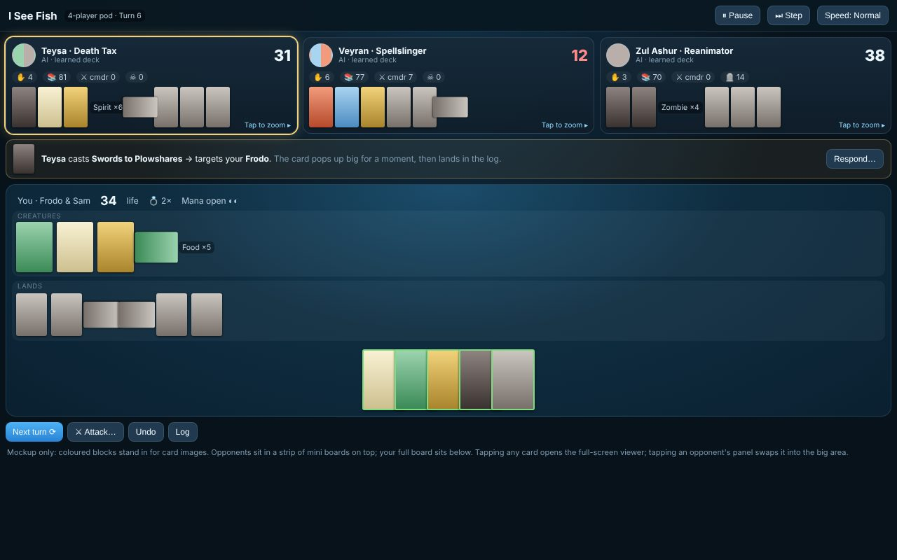
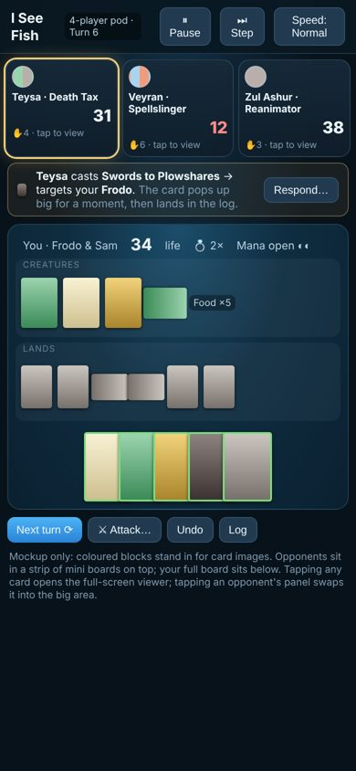

# Roadmap and reference notes

**Primary objective: build the best goldfish simulator out there.** Everything below is for later and must not slow that down.

## Later goals (not started)

- **Play against AI opponents:** you plus up to 3 virtual opponents on the same tabletop, the opponents playing decks the AI has already learned. Start with a *watch mode* (2–4 AI decks auto-run, with pause / step / speed), then let you take one seat.
- **Phone apps:** an app on the App Store and Google Play that people sign in to. The web app is already installable to the Home Screen (it is a PWA); store apps and accounts come after the simulator.
- **Play a friend (since Version 141):** two people on two devices, as it was in Version 128 (Duel → Play a friend). Lobbies and accounts are not planned for now.

## Other tools and how they show games (researched November 2026)

| Tool | What it does | How it shows a game |
|---|---|---|
| [Forge](https://github.com/Card-Forge/forge/wiki/ai) (free, desktop) | Full rules engine with an AI; Commander with 4+ players; a command-line *simulation mode* that runs AI-vs-AI games without a screen | One horizontal strip per player with a stats column, your hand along the bottom, a large card-detail panel on the right. Simulation mode prints results as text only. |
| [XMage](https://www.github.com/magefree/mage/wiki) (free, desktop) | Rules engine with an AI, up to 10 players, a test mode for set-up situations | Strips or quadrants; dense, desktop-only |
| MTG Arena | Brawl against the AI, one opponent | Opponent's board mirrored at the top, avatars and life in the corners, spells shown big in the centre as they are cast |
| [Playgroup.gg](https://playgroup.gg/playtest), [Table Commander](https://tablecommander.com/mtg-commander-simulator), Untap.in | Browser tables for 2–6 human players; import from Moxfield / Archidekt | Equal tiles per player; no AI |
| Moxfield and [Archidekt](https://archidekt.com/news/13186079) playtesters | Solo goldfish | One board, a hand, a log (Archidekt added mana and power tracking) |
| [Commander Bench](https://commander-bench.pages.dev/about) | Language models playing Commander against each other on top of XMage | Research project, not a consumer app |

**The gap ICEYfish can fill:** Forge can run AI-vs-AI games but only shows numbers; the browser tables look good but have no AI. Watching learned decks play out visually, then joining in, with win-rate statistics from many games, is not done well anywhere.

## Layout for you plus up to 3 AI opponents

Mockup: [`mockups/pod-mockup.html`](mockups/pod-mockup.html) (open in a browser), screenshots below. Coloured blocks stand in for card images.

1. **Opponent strip plus your board (recommended).** Opponents in compact panels across the top: life, hand size, library, commander damage, poison or graveyard, and a mini board with identical cards grouped ("Spirit ×6"). A gold outline marks whose turn it is. Your board keeps the full current table below. Tap an opponent's panel to swap their board into the big area.
2. **Four equal tiles (2×2).** Fair to every player, best for watch mode on a big screen; too small for your own board on a phone.
3. **One board at a time (phone).** A bar with all four life totals; swipe between boards, your own by default.

Suggested: option 1 on desktop and tablet with option 3's swipe on phones; option 2 as a toggle for watch mode.

**Making small cards readable:**
- Small hand, full screen on tap (the card viewer already does this); next, put the main action (Cast / Tap) inside the full-screen viewer.
- A spotlight for AI plays: the card pops up large for about 1.5 s ("Teysa casts Swords → targets your Frodo"), then drops into the log, with a **Respond…** button when it targets you.
- Group tokens and identical permanents into counted stacks so four boards stay readable.
- Speed controls: Pause, Step, Normal / Fast / Instant; "stop when something targets me", "stop on my turn".

**Dependency:** the engine (`goldfish/static/sim.js`) plays two players today (the Mirror match). Three or four players is engine work; the screens above can be built first on the two-player mirror match.
